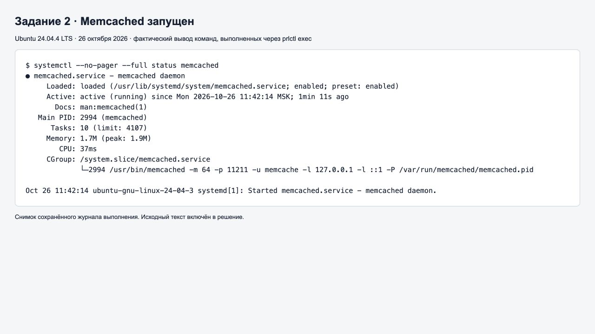
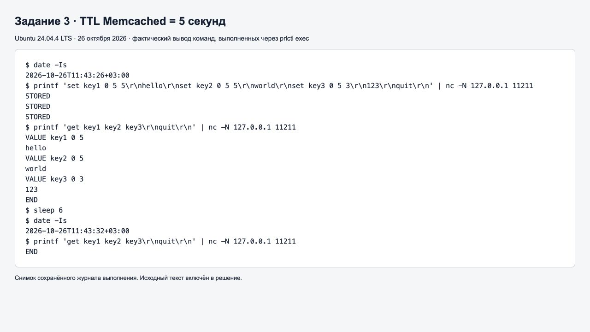
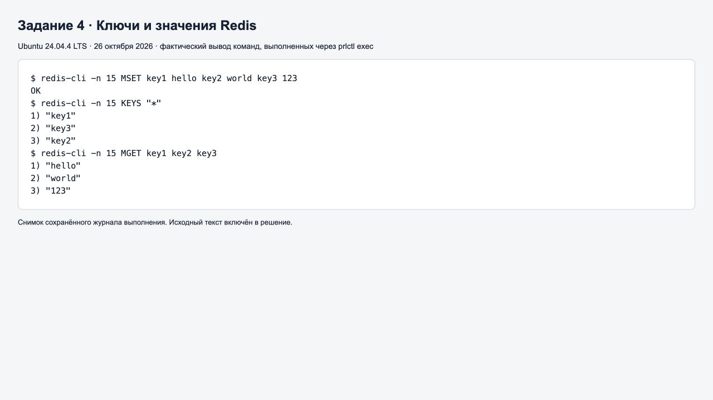
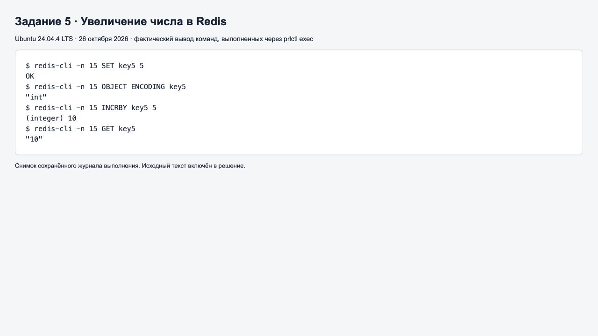

# Домашнее задание «Кеширование Redis/memcached» — Степанов Андрей

[Условия задания](https://netology.ru/profile/program/sysdb-60/lessons/668009/lesson_items/3577866)

Практика выполнена 26.10.2026 в Ubuntu 24.04.4 LTS (ARM64, Parallels Desktop): Memcached 1.6.24 и Redis 7.0.15. Команды выполнены в Linux через `prlctl exec`. Скриншоты ниже показывают сохранённый фактический вывод команд в браузере; исходные журналы и исполняемые Bash-скрипты приложены рядом с README.

## Задание 1. Кеширование

Кеширование сохраняет часто используемые данные или результаты вычислений в быстром хранилище. Оно помогает решить следующие проблемы:

1. **Медленные повторные запросы к БД.** Каталог товаров или карточка товара читаются из кеша, поэтому пользователю не приходится каждый раз ждать выполнения SQL-запроса.
2. **Высокая нагрузка на БД.** При большом числе обращений к одним данным кеш обслуживает повторные чтения и уменьшает число запросов к основной базе.
3. **Дорогие вычисления.** Готовый отчёт, результат агрегации или расчёта сохраняется на некоторое время, что снижает расход CPU и время ответа.
4. **Задержки и ограничения внешнего API.** Кеширование редко меняющегося справочника сокращает количество сетевых запросов и помогает укладываться в лимиты API.
5. **Повторная загрузка статических ресурсов.** Браузерный кеш и CDN уменьшают сетевой трафик и ускоряют загрузку изображений, стилей и скриптов.

У кеша есть ограничения: данные могут устаревать, память ограничена, возможны вытеснения. Поэтому задают TTL и инвалидируют или обновляют кеш при изменении исходных данных. При промахе приложение получает данные из основного хранилища и снова помещает их в кеш.

## Задание 2. Memcached

Установка и запуск в Ubuntu:

```bash
sudo apt-get update
sudo apt-get install -y memcached redis-server netcat-openbsd
sudo systemctl start memcached redis-server
systemctl --no-pager --full status memcached
```

В выводе присутствует `Active: active (running)`. Memcached слушает локальный адрес `127.0.0.1`, порт `11211`.



[Журнал выполнения](02-memcached-status.txt) · [Скрипт проверки](02-memcached-status.sh)

## Задание 3. Удаление по TTL в Memcached

Записаны три ключа: `key1=hello`, `key2=world`, `key3=123`, TTL каждого — **5 секунд**.

```bash
printf 'set key1 0 5 5\r\nhello\r\nset key2 0 5 5\r\nworld\r\nset key3 0 5 3\r\n123\r\nquit\r\n' | nc -N 127.0.0.1 11211
printf 'get key1 key2 key3\r\nquit\r\n' | nc -N 127.0.0.1 11211
sleep 6
printf 'get key1 key2 key3\r\nquit\r\n' | nc -N 127.0.0.1 11211
```

Синтаксис записи: `set <ключ> <флаги> <TTL> <длина значения в байтах>`. Число `5` после флагов задаёт TTL. Длины значений равны 5, 5 и 3 байтам.

Сразу после записи получены три ответа `STORED`, а чтение возвращает все значения. После ожидания 6 секунд, превышающего TTL, чтение возвращает только `END`: ни один ключ больше не доступен. Метки времени на снимке подтверждают интервал 11:43:26–11:43:32. Освобождение памяти просроченного элемента может происходить позже; для клиента ключ уже отсутствует.



[Журнал выполнения](03-memcached-ttl.txt) · [Скрипт проверки](03-memcached-ttl.sh)

## Задание 4. Запись данных в Redis

Для практики выбрана изначально пустая логическая база №15 (`DBSIZE` вернул `0`). Во всех командах используется `-n 15`.

```bash
redis-cli -n 15 MSET key1 hello key2 world key3 123
redis-cli -n 15 KEYS '*'
redis-cli -n 15 MGET key1 key2 key3
```

`MSET` записывает три пары и возвращает `OK`. `KEYS '*'` выводит все ключи учебной базы, а `MGET` получает их значения в порядке переданных имён: `hello`, `world`, `123`. Порядок вывода `KEYS` не гарантирован. На больших рабочих базах вместо блокирующей команды `KEYS` используют итеративный обход `SCAN`.



[Журнал выполнения](04-redis-keys.txt) · [Скрипт проверки](04-redis-keys.sh)

## Задание 5*. Работа с числами

```bash
redis-cli -n 15 SET key5 5
redis-cli -n 15 OBJECT ENCODING key5
redis-cli -n 15 INCRBY key5 5
redis-cli -n 15 GET key5
```

`SET` записывает число `5`. `OBJECT ENCODING` возвращает `int`. `INCRBY key5 5` атомарно увеличивает значение на 5 и возвращает `(integer) 10`; последующее чтение подтверждает значение `10`.

В модели данных Redis это строковый ключ с целочисленным содержимым (`TYPE key5` возвращает `string`), а `int` — его внутренняя кодировка. Отдельного пользовательского типа данных `int` для ключей Redis нет.



[Журнал выполнения](05-redis-incrby.txt) · [Скрипт проверки](05-redis-incrby.sh)

## Источники

- [Протокол Memcached: запись, TTL и чтение](https://docs.memcached.org/protocols/basic/)
- [Redis INCRBY](https://redis.io/docs/latest/commands/incrby/)
- [Шаблон оформления Нетологии](https://github.com/netology-code/sys-pattern-homework)
